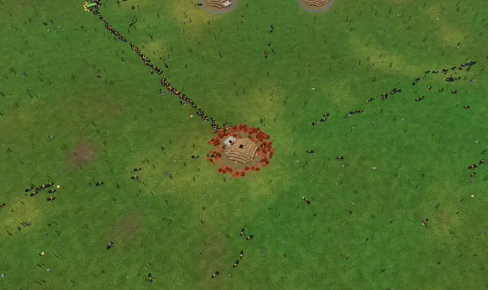
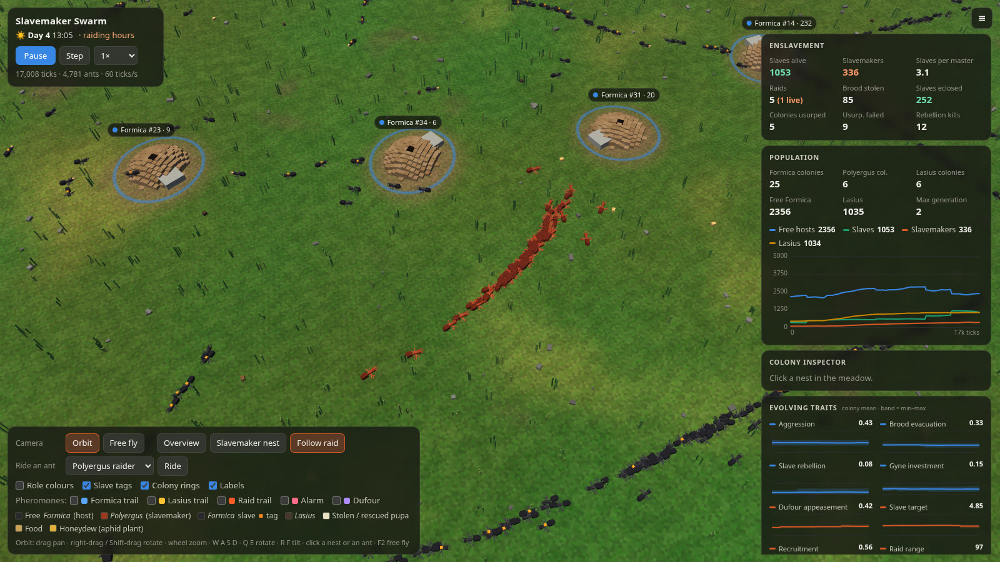

# Slavemaker Swarm

**An individual-based 3-D simulation of *Polyergus* slave raids on *Formica* colonies**

**Emre Ertürk** · Department of Computer Engineering, İzmir Institute of Technology

**[📄 Report](docs/REPORT.md)** · **[▶ Live simulation](https://emreerturk-3.github.io/slavemaker-swarm/)**

<p align="center"></p>
<p align="center"><sub>A raid filmed live from the simulation (<i>Follow raid</i> camera). Red-brown <i>Polyergus</i> raiders follow the scout's trail to a <i>Formica</i> nest (blue ring), take its brood and carry it home (orange ring).</sub></p>

A live 3-D swarm simulation of **slave-making ants**. *Polyergus* (the "Amazon ant") colonies scout,
muster and send raid columns against **_Formica fusca_-group** host nests, carry the brood home, and
let it eclose as slaves. Those slaves then forage, nurse and feed their captors. A **_Lasius_**
competitor shares the meadow and is never raided. Mated *Polyergus* queens take over whole *Formica*
colonies by killing the resident queen. Enslaved workers can rebel by killing slavemaker pupae.

Ants are voxel models walking on a grassy meadow with dirt nest mounds, *Formica* nest stones,
aphid plants dripping honeydew, and scattered food. A day/night cycle drives activity, and raids happen
in the late afternoon, as in the field. Coordination is pheromone-driven (food trails, the raid trail,
alarm, and Dufour's-gland secretion), and every chemical layer can be shown as an overlay. Colony
traits (host defence, rebellion, raid strategy, chemical appeasement, reproduction) are inherited
through dispersing queens with mutation, so the host–parasite arms race evolves as you watch.

See **[docs/REPORT.md](docs/REPORT.md)** for the biology, the model, calibration, results and references.

**Results in brief** (two headless runs of 12.5 simulated days): the founding colony raids about once a
day, always in the late afternoon (field: 38 raids in 32 days). Queen usurpation succeeds 25–35 % of the
time and is the bottleneck for spread. The same parameters give two regimes: a stable parasite, or an
invasion from 1 to 7 *Polyergus* colonies.



## Run it

No build step and no dependencies.

```bash
# open directly (classic scripts, works from file://)
xdg-open index.html

# or serve it (no-cache dev server, also used by the headless test harness)
python3 tools/server.py 8765      # then open http://localhost:8765/
```

URL options: `?seed=7&hosts=16&lasius=3&warm=5000&select=P&cam=slaver&dist=40&ride=raider&view=eye&mode=fly`
(`warm` pre-runs N ticks; `select=P` selects the first slavemaker colony; `cam=slaver|raid` points the camera at it; `ph=2,3` turns on pheromone layers).

## Controls

| Input | Action |
|---|---|
| drag | pan |
| right-drag / shift-drag | rotate and tilt |
| wheel / pinch | zoom |
| click a nest | open it in the colony inspector |
| double-click | fly to that spot |
| W A S D · Q E · R F · Z X | pan · rotate · tilt · zoom (held keys, smooth) |
| Space | pause |
| **Orbit / Free fly** (Esc / F2) | free fly: W A S D move, Q / E down / up, drag to look, Shift boost, wheel sets speed |
| **Ride an ant** | chase-cam on a raider, slave, scout, free host, *Lasius* or flying queen, or click any ant when zoomed in. Drag looks around it, wheel sets distance, **V** toggles ant-eye view, **N** jumps to another ant. An ID card shows its colony, task, cargo and, for slaves, the colony it was stolen from |
| **Slavemaker nest** | fly to a *Polyergus* nest (repeat to cycle) |
| **Follow raid** | camera tracks the raid column out and back |
| Role colours | recolour ants by role: free host blue, slavemaker orange, slave green, *Lasius* amber |
| Slave tags | orange tag on enslaved *Formica* in natural-colour mode |
| Colony rings | ground ring per nest. Pulses red under attack, flashes green when a slave ecloses |
| Pheromones | overlay any of the five chemical fields |

## What you are looking at

| Thing | Look |
|---|---|
| *Formica* worker (free host) | black-grey ant |
| *Polyergus* worker | larger red-brown ant with sickle mandibles |
| enslaved *Formica* | black ant with an orange tag (or green in role colours) |
| *Lasius* worker | small dark-brown ant |
| cream block in an ant's jaws | pupa (cocoon). Pure white = larva |
| honey-coloured blocks | honeydew under an aphid plant |
| brown / black / tan blocks | dead arthropods and seeds |
| dirt mound with flat stone | *Formica* nest (*F. fusca* nests under stones). Darker mound = *Lasius* |
| pale winged ant flying | dispersing queen (gyne) |

## Code layout

```
index.html, style.css     page, HUD, side panel
src/core.js               RNG, constants, species/state enums, trait definitions, genomes
src/world.js              pheromone channels (bounded-region diffusion/evaporation), food, aphid plants
src/colony.js             queen, brood pipeline, food, task allocation, raid scheduling, gynes
src/sim.js                agent arrays, behaviour state machine, combat, usurpation, history
src/render3d.js           WebGL2: terrain, instanced voxel ants/mounds/food/plants, lighting, overlays
src/charts.js             population and trait-evolution charts
src/main.js               loop, camera, labels, alerts, inspector, controls
tools/server.py           dev server with a POST /result sink
tools/headless.html       runs the sim without rendering and posts a text summary (?ticks=&seed=&every=)
```

The simulation core (`core/world/colony/sim.js`) never touches the DOM, so it also runs headless:

```bash
python3 tools/server.py 8765 result.json &
firefox --headless --screenshot ~/headless.png "http://localhost:8765/tools/headless.html?ticks=60000&every=6000&seed=2"
cat result.json
```

## Citation

```bibtex
@misc{erturk2026slavemaker,
  author = {Ertürk, Emre},
  title  = {Slavemaker Swarm: an individual-based simulation of {Polyergus} slave raids on {Formica} colonies},
  year   = {2026},
  note   = {Project report v0.2},
  url    = {https://github.com/EmreErturk-3/slavemaker-swarm}
}
```
